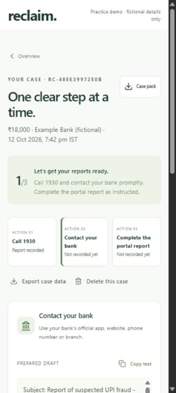
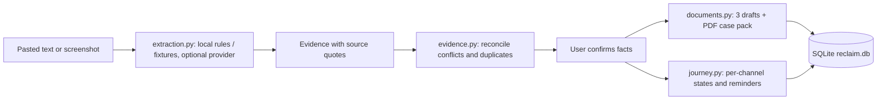

# Reclaim

A guided assistant that helps a victim of online payment fraud in India prepare their reporting paperwork (1930 helpline, bank, cyber-crime portal) and keep track of what they reported and when. It never files anything itself.

**Links:** [GitHub](https://github.com/shriram-s7/Reclaim)

> Local prototype that uses fictional data only. The backend has no authentication; do not expose it online or enter real personal data.

## Overview

After a UPI or card scam the first hours matter, but victims are asked for the same facts (amount, reference number, recipient, time) by several bodies, in different formats. Reclaim collects those facts once, lets the user confirm them, and produces consistent drafts for each channel plus a downloadable case pack. It then tracks the user's own entries: which channel was contacted, when, the reference they were given, and what happens next. Built for the Founder's Code hackathon (14-15 October 2026); see `PRE_EXISTING.md` for the pre-event disclosure and `docs/MASTER_PLAN.md` for the plan.



## Features

**Case preparation**
- Short five-step intake, optionally pre-filled by reading a pasted text message or a payment screenshot; every fact shows its source quote and must be confirmed by the user.
- Conflict and possible-duplicate detection across evidence, multiple confirmed payments, and re-confirmation after corrections.
- Three consistent drafts (same amount, reference and recipient) and a PDF **case pack** plus JSON export.

**Tracking**
- Per-channel reporting states: not started, later, no answer, reported/waiting, resolved.
- User-entered reference numbers and actual reporting times; in-app reminders and calendar export.

**Review views**
- Review workspace with progress, `/bank` review queue, and `/stage` side-by-side presentation view.
- English and Tamil interface (the Tamil catalogue awaits native-speaker review; drafts and PDF are English).

## How it works



Evidence comparison is rules-based; matching tolerances are not independently validated, so human confirmation is required. A live AI provider adapter exists but is off unless configured; no live-provider accuracy evaluation is recorded, and the bundled fixtures must not be read as AI accuracy.

## Tech stack

| Layer | Technology |
|---|---|
| Backend | Python 3.12, FastAPI, Uvicorn, Pydantic |
| Storage | SQLite (`reclaim.db`, git-ignored) |
| PDF | ReportLab |
| Frontend | React, TypeScript, Vite, lucide-react (served from `frontend/dist` by the backend) |
| Optional AI reading | Anthropic API adapter (`backend/app/provider.py`) |
| Tests | pytest |

## Project structure

| Location | Purpose |
|---|---|
| `backend/app` | validation, extraction, evidence, journey, drafts, PDF, API |
| `backend/tests` | behaviour and failure tests |
| `frontend/src` | responsive assistant, queue and presentation view |
| `samples` | fictional receipt and generators (`synthetic-payment.png`, held-out set) |
| `scripts` | `setup.ps1`, `verify.ps1`, `run.ps1`, extraction evaluation |
| `docs` | master plan, decisions, progress, screenshots |
| `STATUS.md`, `AGENTS.md` | latest verified state and working notes |

## Getting started

Prerequisites: Python 3.12+ and Node 20.19+ with npm. Internet is needed for installation only.

**Windows (PowerShell)**

```powershell
.\scripts\setup.ps1     # creates .venv, installs backend and frontend, builds the frontend
.\scripts\verify.ps1    # runs tests and the production build
.\scripts\run.ps1       # serves http://127.0.0.1:8000
```

**Linux / macOS** (the helper scripts are PowerShell only, so do it by hand)

```bash
python3 -m venv .venv && source .venv/bin/activate
pip install -r backend/requirements.txt
cd frontend && npm ci && npm run build && cd ..
uvicorn backend.app.main:app --host 127.0.0.1 --port 8000
```

Open http://127.0.0.1:8000. For frontend development keep the API running and use `npm run dev` in `frontend`; restart the backend after backend changes.

**Environment variables** are all optional; see [`.env.example`](.env.example): `RECLAIM_DB`, `RECLAIM_EXTRA_HOSTS`, `RECLAIM_EXTRACTION_PROVIDER=anthropic` with `ANTHROPIC_API_KEY` for live reading, plus timeout/model/effort tuning. The app reads real environment variables, not a `.env` file.

## Usage: a 90-second demo

1. Point out the immediate 1930 / bank actions on the home screen.
2. Prepare my case, use the fictional sample, review details, confirm, create the case.
3. Show the same amount, reference and recipient in all three drafts.
4. Enter fictional report references and demo reporting times; record each action.
5. Open the review workspace to show progress, then download the case pack.

`samples/synthetic-payment.png` is a deliberately labelled synthetic image: download it from the form and upload it through "Try sample image". Unknown images fall back to manual entry. Images are not retained or included in the case pack.

## Tests

```bash
pytest backend/tests
cd frontend && npm run build
```

Observed while writing this README: **97 backend tests passed** (17 s). The frontend build was not re-run here.

## Status and limitations

- English and Tamil interface; the Tamil catalogue is unreviewed by a native speaker.
- No government submission, bank integration, push/SMS reminders, authentication or payments. Reporting records are user-entered, not official confirmations, and a case pack is not evidence that a report was filed or funds recovered.
- No legal eligibility or compensation calculation (`docs/DECISIONS.md`).
- Not yet tested with an independent user on a real phone; the live provider has not been evaluated (`STATUS.md`).

## Credits

Built by the hackathon team; see `PRE_EXISTING.md` and `docs/PROGRESS.md`.

## License

No license specified.
